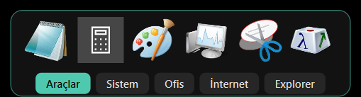
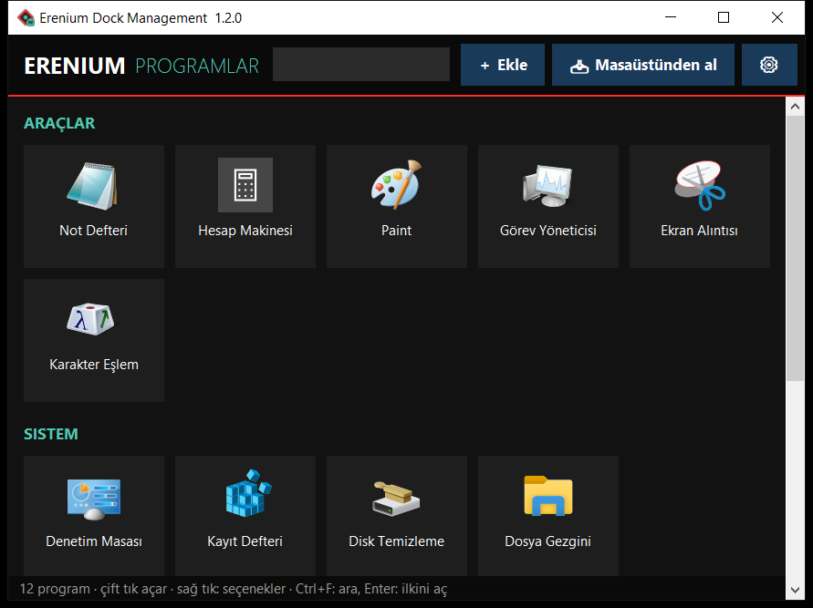

# Erenium Dock

Windows için ekran kenarında duran, sekmeli program şeridi. Programlarınızı, kısayollarınızı ve klasörlerinizi tek yerden açın; masaüstünüz sade kalsın.

**[⬇ Son sürümü indir](https://github.com/malieren/erenium-dock/releases/latest)**

## Özellikler

- **Sekmeli şerit:** Programları gruplara ayırın, her grup bir sekme olsun.
- **Tek tıkla açma:** Program zaten açıksa yenisi açılmaz, penceresi öne gelir.
- **Explorer sekmesi:** Masaüstü, Belgeler, İndirilenler ve sürücüler hazır gelir; kendi klasörlerinizi ekleyebilirsiniz.
- **Sağ tıkla ekleme:** Windows Gezgini'nde exe, kısayol veya klasöre sağ tıklayıp grubu seçin; pencere açılmadan eklenir.
- **Görünüm ayarları:** Ekran kenarı, ikon boyu, renk, saydamlık, köşe ve çerçeve.
- **Akıllı katman:** Tam ekran programların önüne geçmez; fareyi ekran kenarına dayayınca öne gelir.

## Kurulum

1. [Releases](https://github.com/malieren/erenium-dock/releases/latest) sayfasından zip dosyasını indirin.
2. Zip'i açıp klasörü kalıcı bir yere koyun (örneğin `Belgeler\Erenium`). Masaüstünde veya İndirilenler'de bırakmayın.
3. `Erenium Dock.exe` dosyasına çift tıklayın.

İlk açılışta Başlat menüsü kısayolları oluşturulur ve Erenium Dock Windows açılışına eklenir. Bunu Dock menüsünden kapatabilirsiniz.

Windows "Bilgisayarınız korundu" uyarısı verirse **Ek bilgi → Yine de çalıştır** seçin. Program imzasız olduğu için bu uyarı çıkar. Dosyanın değişmediğini, sürüm notlarındaki SHA-256 değeriyle kontrol edebilirsiniz.

## Kullanım

- **Tek tık:** Programı açar.
- **Fare tekerleği:** Sekme değiştirir.
- **Sağ tık:** Kenar, ikon boyu, otomatik gizleme ve görünüm ayarları.
- **Program eklemek:** Dock'a sağ tık → **Erenium Dock Management**.
- **Sağ tık menüsünü açmak:** Management menüsünden **Sağ tık menüsüne ekle**.

## Güvenlik

Erenium Dock, kayıtlı kısayol ve programlarınızı denetler:

- Kısayolun hedefi veya dosyanın içeriği değişirse kaydı engeller ve açmadan önce sorar.
- İmzası aynı kalan normal program güncellemeleri uyarı vermez.
- Komut çalıştırıcılarını ve geçici klasörden çalışan hedefleri işaretler.
- İnternetten indirilmiş imzasız dosyaları ilk açılışta sorar.
- Kendi dosyalarının değişip değişmediğini kontrol eder.

Bu denetimler bir antivirüsün yerini tutmaz.

## Gizlilik

Program listeniz ve ayarlarınız sadece bilgisayarınızda, programın `veri` klasöründe durur. Hesap gerekmez.

İnternete yalnızca güncelleme denetimi için çıkar: günde en fazla bir kez GitHub'dan son sürüm numarasını okur, kişisel bilgi göndermez. Dosya indirmez; yeni sürüm varsa sorar ve indirme sayfasını tarayıcınızda açar. Bu denetimi Dock menüsünden kapatabilirsiniz.

## Gereksinimler

- Windows 10 veya üzeri (64 bit)
- `.py` programlarını Dock'tan açmak için bilgisayarda Python kurulu olmalıdır. Program için başka bir kurulum gerekmez.

## Sorun bildirme

Hata ve önerilerinizi [Issues](https://github.com/malieren/erenium-dock/issues) sayfasından iletebilirsiniz.

Web: [www.sanatsende.com.tr](https://www.sanatsende.com.tr)

## Lisans

Erenium Dock ücretsiz kullanılabilir, kaynak kodu kapalıdır. Ayrıntılar için [LICENSE.txt](LICENSE.txt) dosyasına bakın.
